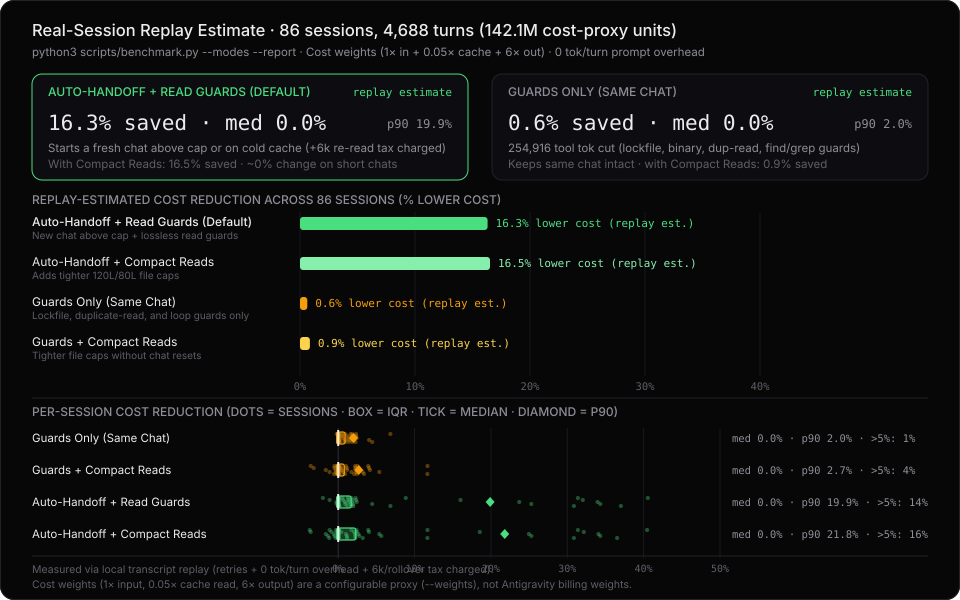

# agy-tokensaver

<p align="center">
  <a href="https://github.com/menscho/agy-tokensaver/releases"></a>
  <a href="https://github.com/menscho/agy-tokensaver/actions/workflows/test.yml"></a>
  <a href="https://github.com/menscho/agy-tokensaver/actions/workflows/test.yml"></a>
  <a href="LICENSE"></a>
</p>

A local token, cache, and quota optimizer for **Google Antigravity** (CLI & IDE), with a full-page native HUD (`agy-tokensaver`).

---

## Install & Update

**Installer:** download `agy-tokensaver-v1.0.0.zip` from **[Releases](https://github.com/menscho/agy-tokensaver/releases)**, extract, and run **`Install-TokenSaver.bat`** (Windows), **`Install-TokenSaver.command`** (macOS), or `python3 install.py`.

**Or from a terminal:**
```bash
# Linux / macOS / WSL
curl -fsSL https://raw.githubusercontent.com/menscho/agy-tokensaver/main/install.sh | bash
```
```powershell
# Windows PowerShell
irm https://raw.githubusercontent.com/menscho/agy-tokensaver/main/install.ps1 | iex
```

**Updates:** open **`agy-tokensaver`** in the Antigravity sidebar → **Updates** → **Install Update**. Updates install only from tagged GitHub Releases after checking `SHA256SUMS.txt` from the same release (catches corrupted downloads; not a separate cryptographic signature). Local stats, settings, and archived handoffs in `~/.gemini/antigravity/plugin_data/token-saver/` are never overwritten.

*(Requires Python 3.9+ stdlib and Perl 5 stdlib — zero external packages or API keys.)*

---

## Where Your Antigravity Quota Actually Goes (Why Hooks Alone Look Small)

Across **66 real Antigravity sessions (3,648 turns, 101.3M weighted quota units)** measured with `scripts/benchmark.py --modes`, quota breaks down into three almost-equal buckets:

- **37.5% — Uncached Input (`1×` weight):** over **half (`19.1M` tokens = `19%` of total quota)** came from just **109 prompt-cache drops** (idle pauses `>2 min` on 150k–450k chats forcing a full uncached rebuild).
- **31.6% — Cache Reads (`0.05×` weight):** replaying a growing 150k–500k context window across dozens of turns ($O(T^2)$ growth).
- **30.9% — Model Output (`6×` weight):** every generated token costs 6× an uncached input token and 120× a cached token.

**This explains a hard truth about every coding-agent token plugin (confirmed independently by JetBrains SkillsBench on RTK):** pure shell/file hooks only touch *new tool outputs* (~4–5% of total session quota on clean chats, though **-76%** on noisy logs/tests/JSON). To cut **15–40% of real total quota**, you have to attack **output tokens (6×)** and **long-session context / cache drops** too — which is why `agy-tokensaver` separates **Zero-Loss Core Hooks** from **three opt-in modes**, each benchmarked independently below.

---

## Mode-by-Mode Real-Session Benchmark (66 Sessions / 3,648 Turns)

Reproduce on your own Antigravity history:
```bash
python3 scripts/benchmark.py --modes    # compares every mode separately
python3 scripts/benchmark.py --replay   # full tier-by-tier breakdown
```

| Mode Configuration | Quality Risk | Tool Tokens Cut | Total Quota Delta |
|---|---|---:|---:|
| **1. Zero-Loss Hooks** *(Default ON, Auto-Handoff OFF)* | **0%** (exact replay) | 216,758 tok | **-0.7%** |
| **2. + Compact Reads** *(Opt-in, Auto-Handoff OFF)* | **~0.1–0.5%** (exact replay) | 321,950 tok | **-1.0%** |
| **3. + Concise Output (`-20%` conservative)** *(Opt-in, Auto-Handoff OFF)* | **~0.1%** prose only *(modeled\*)* | 216,758 tok | **-6.9%** |
| **4. + Concise Output (`-35%` moderate)** *(Opt-in, Auto-Handoff OFF)* | **~0.1%** prose only *(modeled\*)* | 216,758 tok | **-11.5%** |
| **5. + Smart Auto-Handoff (Live-Reachable)** *(Opt-in, default reads)* | Fresh chat\*\* (causal replay) | 216,758 tok | **-17.6%** |
| **6. + Auto-Handoff Live + Compact Reads + Concise Output\*** | Combined\*\* | 321,950 tok | **-24.1% to -28.7%** |
| **7. + Auto-Handoff Upper Bound + Compact + Concise\*** | Upper bound\*\* | 321,950 tok | **-39.8% to -44.4%** |

*\* **Concise Output** cannot be replayed on past transcripts without re-calling the LLM; rows 3, 4, 6, 7 apply conservative `-20%` and `-35%` output reductions to the real `30.9%` (`6×`-weighted) output bucket (published benchmarks report `-45%` on SWE-bench for Chain-of-Draft and `-65%` prose reduction for Caveman). Rows 1, 2, and 5 are exact deterministic replays charging retries, follow-up reads, and the plugin's `433 tok/turn` prompt overhead.*  
*\*\* **Live-Reachable** only triggers Auto-Handoff between finished agent runs where the background tick can actually fire; **Upper Bound (UB)** shows the ceiling if rolling over at any turn.*

<p align="center">
  
</p>

### Pros & Cons of Every Mode (All Toggleable in the `agy-tokensaver` HUD)

| Mode | Default | Pros | Cons / Trade-Offs |
|---|---|---|---|
| **Zero-Loss Hooks** | **ON** | **0% quality loss.** Blocks lockfiles/binaries, crushes JSON arrays to lossless `[N]{cols}` CSV+schema, hoists repeated grep/SSH paths, folds repeated log blocks, dedupes unchanged reads/searches (1-retry escape hatch), pins errors & spills raw logs to temp dir. | Modest aggregate impact (`-0.7%`) on short, clean chats; short sessions still pay `433 tok/turn` for always-loaded rules/skills. |
| **Compact Reads** (`compact_reads`) | **OFF** | Cuts **+48% more tool tokens** (`216k → 322k`) by capping large unbounded code reads to `120 L` and unbounded docs `>12 KB` to `140 L`. Bounded `StartLine..EndLine` slices stay untouched. | **~0.1–0.5% risk:** if the needed function is below line 120 in an unbounded read, the agent spends 1 extra targeted read turn (already charged in row 2 above). |
| **Concise Output** (`concise_output`) | **OFF** | Attacks the `30.9%` (`6×` weight) output bucket directly (**`-6.9%` to `-11.5%` total quota even with Auto-Handoff OFF**). Strips pleasantries, preambles, and pre/post-tool chatter; code, diffs, paths, and errors stay 100% verbatim. | **~0.1% prose risk:** replies are terse and skip narrative explanations. Change only between sessions to keep prompt-cache prefixes intact. |
| **Smart Auto-Handoff** (`smart_auto`) | **Archive Only** | Biggest real savings on long chats: **`-17.6%` live-reachable** overall (`-27.7%` on `>400k` chats), preventing both $O(T^2)$ cache replay and 200k-token idle cache-drop rebuilds. | Starts a fresh chat with a structured handoff packet — see exact quality & memory explanation right below. |

---

## What Auto-Handoff Actually Does (And Does the Model Forget Everything?)

This is the most common question, so here is the plain, honest answer:

1. **What it does:** When a long conversation crosses the adaptive threshold (~110k–180k tokens), `handoff_pack.py` generates a compact (~500-token) structured continuation packet from your workspace and transcript:
   - Your **current goal** and the **assistant's last conclusion**
   - **Git branch, recent commits, diff stat, and exact list of edited files**
   - Relevant workspace state
   It saves this snapshot to the **Archive** tab. If you select **`Smart Auto`**, it also opens a fresh chat seeded with that packet (~17k starting tokens instead of 250k–500k).
2. **Does the model forget stuff?** **Yes — selectively.**
   - **What is kept:** your goal, edited file list, git state, last conclusion, and every file on disk (which the agent can still read at any time).
   - **What is dropped:** old terminal logs, dead-end debugging attempts from 60 turns ago, and earlier file slices that are no longer needed (the full original chat stays untouched in your Antigravity history and Archive tab).
3. **What is the real quality loss?**
   - **At a phase switch** (finished feature A → starting feature B, finished planning → implementing, or before taking a `>2 min` break): **near-0% quality loss** — and often *better* focus, because JetBrains' NeurIPS 2025 study (*The Complexity Trap*, `arXiv:2508.21433`) showed removing stale observation bloat improves or matches SWE-bench solve rates while cutting cost ~50%.
   - **Mid-debugging a subtle multi-file bug** where 5 hypotheses were already ruled out: **real risk** — the fresh chat may re-read 1–2 files or re-try a ruled-out path unless that summary was recorded in the last turn.
4. **Why the default is `Archive Only`:** Auto-Handoff does **not** automatically spawn new chats out of the box. It silently archives handoff snapshots and warns you before huge idle cache drops so *you* can click **Archive & New Chat** (or type `/handoff`) right at natural boundaries. Switch to **`Smart Auto`** only if you want hands-off resets on marathon sessions.

---

## 8-Step Noisy-Task Demo (`python3 scripts/benchmark.py --demo`)

Runs a deterministic 8-step noisy coding fixture directly through `read_hook.pl`, `cmd_hook.pl`, and `cmd_wrap.pl` (baseline capped at Antigravity's native limits: `46,080 B` read / `10,136 B` command; post-hook includes the `94 B` overwrite notice; median hook latency **~8 ms**):

| Task Step | Without | With | Saved | Result |
|---|---:|---:|---:|---|
| 1. `read_file` `package-lock.json` (unbounded) | 11,520 tok | 41 tok | -99.6% | blocked (hint emitted) |
| 2. `read_file` `service.py` (900L unbounded) | 11,520 tok | 4,844 tok | -58.0% | capped to lines 1–250 |
| 3. `read_file` `service.py:50-120` (dup slice) | 1,359 tok | 36 tok | -97.4% | blocked (already in context) |
| 4. `run_command` `pytest` (300 pass, 1 fail) | 2,534 tok | 108 tok | -95.7% | `--cat test`: assertion + traceback kept |
| 5. `run_command` `git diff` (code + lockfile) | 2,534 tok | 107 tok | -95.8% | `--cat git_diff`: code hunk verbatim |
| 6. `run_command` server log (900L + 1 ERROR) | 2,534 tok | 1,550 tok | -38.8% | `--cat logs`: `ERROR` pinned + raw saved |
| 7. `run_command` `curl` JSON API (120 rows) | 2,534 tok | 940 tok | -62.9% | `--cat http`: CSV+schema & error row kept |
| 8. `run_command` `ssh` remote grep (74 hits) | 1,847 tok | 959 tok | -48.1% | `--cat ssh`: lossless path hoisting |
| **Total direct tool tokens** | **36,383 tok** | **8,588 tok** | **-76.4%** | **27,795 tokens avoided** |
| **15-turn weighted quota (`1×` in + `14×0.05×` cr)** | **61,851 qu** | **14,599 qu** | **-76.4%** | **47,252 quota units avoided** |

*(This fixture represents a noisy test/log/JSON/diff workflow; clean small-file sessions save much less with hooks alone, as shown in the 66-session replay above.)*

---

## Native HUD

Opens from **`agy-tokensaver`** under **Plugins** in Antigravity's left sidebar. Internal dashboard tools use `visibility: ["app"]` so they add zero tokens to the model prompt.

<p align="center">
  
</p>

- **Overview:** Input/Cache/Output/Quota breakdown, live context meter, Rollover Mode (`Archive Only` / `Smart Auto` / `Off`), opt-in **Compact Reads** & **Concise Output** toggles, and manual actions.
- **Archive:** Saved compact handoff packets (goal, branch, commits, diff stat, edited files, last summary).
- **Updates:** Tagged GitHub Release check, local requirement checks, changelog, and SHA-256 verified 1-click updates.

---

## Research & Open-Source Foundations

Techniques implemented in `agy-tokensaver` are grounded in published coding-agent efficiency research and verified open-source tools (while deliberately excluding techniques shown to hurt cost or quality):

- **[headroomlabs-ai/headroom](https://github.com/headroomlabs-ai/headroom):** ported lossless JSON `[N]{cols}` CSV+schema compaction, nested flattening, `>256 B` blob offload, 12-keyword error-preserving SmartCrusher sampling, dense minified-line elision, repeated multi-line block folding, large-diff `±2` context trimming, and Windows-safe grep path hoisting into zero-dependency Perl (`cmd_wrap.pl`).
- **[@plexer/cli](https://www.npmjs.com/package/@plexer/cli):** ported `PostToolUse` edit invalidation (`post_edit_hook.pl`), duplicate search / unchanged `git diff` dedup with a 1-retry escape hatch, `WaitMsBeforeAsync` floor bump (`5000 ms`) on fast read-only queries, `initialNumSteps` compaction reset, and stdlib AST/regex symbol outlining (`ts_inspect.py outline`).
- **JetBrains *The Complexity Trap* (`arXiv:2508.21433`, NeurIPS 2025) & *Don't Break the Cache* (`arXiv:2601.06007`):** motivates keeping prompt prefixes strictly append-only (never mutating history mid-turn — which `arXiv:2611.22238` showed increases cost 38–116% by breaking KV caches!) and instead using coarse threshold handoffs + pre-drop idle warnings.
- **[Caveman](https://github.com/JuliusBrussee/caveman) & *Chain of Draft for Software Engineering* (`arXiv:2506.10987`):** motivates the opt-in **Concise Output** mode targeting the `6×`-weighted output bucket without touching code, paths, or errors.
- **Deliberately excluded anti-patterns:** lexical code minification (`arXiv:2606.01326`: causes a 12-point SWE-bench drop), per-turn sliding history mutation (`arXiv:2611.22238`: breaks prefix cache), and unsolicited Turn-0 snippet pre-injection (`arXiv:2611.22238`: +33–42% net cost).

---

## Compatibility, Limitations & Tests

- **Antigravity IDE vs. CLI hooks:** Hooks fire reliably in Antigravity 2.0 and the `agy` CLI (verify via `/hooks` or by watching hook events increment in the HUD). Older desktop IDE builds that don't fire plugin hooks yet still benefit from `rules/AGENTS.md`, skills, scouts, `ts_inspect.py`, `handoff_pack.py`, and the HUD.
- **Cross-platform:** Full CLI wrapping runs on Linux, macOS, WSL, **and native Windows PowerShell** (`cmd_wrap.pl --pwsh-stdin` via child `powershell.exe` with exact exit codes, table compaction, and `%TEMP%` spillback; `AGY_TS_SHELL=off|posix|pwsh` overrides).
- **Fail-open invariant:** Every hook fails open (`{"decision":"allow"}` / `{}`) on any malformed input or Antigravity payload change, and every lossy compression spills the unmodified raw output to disk first.

```bash
for t in tests/run_tests.sh tests/test_*.sh; do bash "$t"; done
python3 scripts/benchmark.py --demo --modes
```

Verified in [`.github/workflows/test.yml`](.github/workflows/test.yml) across **Ubuntu, macOS, and Native Windows** (`297` assertions across 7 test suites + MCP/installer/PowerShell/demo checks).

## License

[MIT License](LICENSE).
