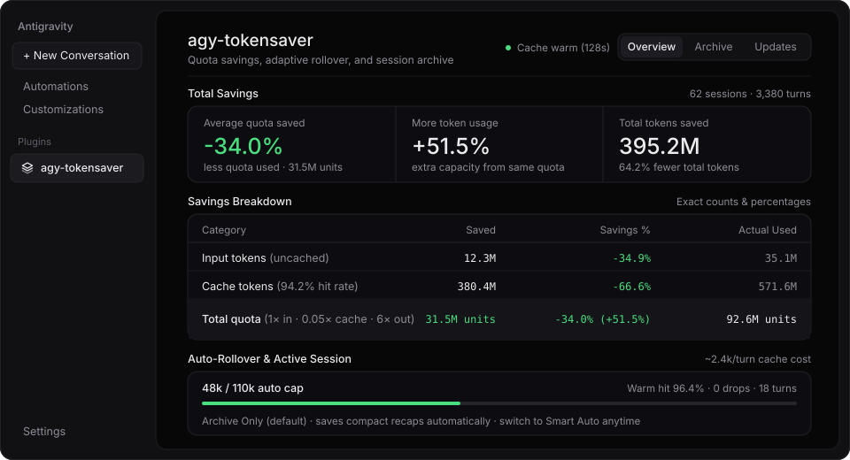

# agy-tokensaver

<p align="center">
  <a href="https://github.com/menscho/agy-tokensaver/releases"></a>
  <a href="https://github.com/menscho/agy-tokensaver/actions/workflows/test.yml"></a>
  <a href="LICENSE"></a>
</p>

A local token, cache, and quota optimizer plugin for **Google Antigravity**.

Coding agents burn quota by pulling large noisy command logs, lockfiles, and repeated file slices into context — where every byte gets replayed on later turns — and by letting long sessions grow past 200k–500k tokens where idle pauses trigger full uncached cache rebuilds. `agy-tokensaver` filters noisy tool I/O locally with fail-open Perl hooks, keeps raw outputs on disk, and provides an optional full-page dashboard (`agy-tokensaver`) for tracking usage and archiving compact handoffs.

---

## Install & Update

**Installer:** download `agy-tokensaver-v1.0.0.zip` from **[Releases](https://github.com/menscho/agy-tokensaver/releases)**, extract, and run **`Install-TokenSaver.bat`** (Windows), **`Install-TokenSaver.command`** (macOS), or `python3 install.py`.

**Or from a terminal:**
```bash
# Linux / macOS / WSL
curl -fsSL https://raw.githubusercontent.com/menscho/agy-tokensaver/main/install.sh | bash
```
```powershell
# Windows PowerShell
irm https://raw.githubusercontent.com/menscho/agy-tokensaver/main/install.ps1 | iex
```

**Updates:** open **`agy-tokensaver`** in the Antigravity sidebar → **Updates** tab → **Install Update** (or re-run the installer). Updates pull **only from tagged GitHub Releases** after checking **`SHA256SUMS.txt`** from the same release (catches corrupted downloads; not a separate cryptographic signature). Local stats, settings, and archived handoffs live in `~/.gemini/antigravity/plugin_data/token-saver/` and are never overwritten.

*(Requires Python 3.9+ stdlib only; on Windows, `install.py` pins the active Python path in `mcp_config.json` to avoid the Microsoft Store `python3` stub. Perl 5 is required for the hooks.)*

---

## Reproducible Benchmarks

Every number below is produced directly by [`scripts/benchmark.py`](scripts/benchmark.py) — no hand-estimated multipliers.

### 1. Measured Before / After Task (Auto-Handoff OFF — Hooks Only)

Reproduce locally in ~1 second (also verified in CI):
```bash
python3 scripts/benchmark.py --demo
```

Runs a deterministic 6-step noisy-task fixture through `read_hook.pl`, `cmd_hook.pl`, and `cmd_wrap.pl`. Each command step inspects `cmd_hook.pl`'s actual rewrite output (failing if a command is not wrapped on POSIX) and verifies the target signal survives compression. Baseline counts are capped at Antigravity's native limits (`46,080 B` for `read_file`, `10,136 B` for `run_command`), and post-hook counts include the `94 B` PreToolUse overwrite notice.

| Task Step | Without Plugin | With Plugin | Saved | Result |
|---|---:|---:|---:|---|
| 1. `read_file` `package-lock.json` (unbounded) | 11,520 tok | 41 tok | -99.6% | blocked (hint emitted) |
| 2. `read_file` `service.py` (900L unbounded) | 11,520 tok | 4,844 tok | -58.0% | capped to lines 1–250 |
| 3. `read_file` `service.py:50-120` (dup slice) | 1,359 tok | 39 tok | -97.1% | blocked (already in context) |
| 4. `run_command` `pytest` (300 pass, 1 fail) | 2,534 tok | 108 tok | -95.7% | `--cat test`: assertion + traceback kept |
| 5. `run_command` `git diff` (code + lockfile) | 2,534 tok | 107 tok | -95.8% | `--cat git_diff`: code hunk verbatim |
| 6. `run_command` server log (900L + 1 ERROR) | 2,534 tok | 1,550 tok | -38.8% | `--cat logs`: `ERROR` pinned + raw saved |
| **Total direct tool tokens added to context** | **32,001 tok** | **6,691 tok** | **-79.1%** | **25,310 tokens avoided** |
| **15-turn weighted quota (`1×` in + `14×0.05×` cache)** | **54,401 qu** | **11,374 qu** | **-79.1%** | **43,027 quota units avoided** |

Measured median `PreToolUse` hook wall-clock time across the 6 calls: **~6 ms** (including process spawn). This demo is a noisy-task best case (lockfile, 900-line file, 300-test run, lockfile diff, 900-line log); typical sessions with small clean reads and short commands will save much less.

### 2. Simulated Rollover Upper Bound (Auto-Handoff ON — 62 Local Transcripts)

Reproduce on your own Antigravity transcripts:
```bash
python3 scripts/benchmark.py --transcripts
```

<p align="center">
  
</p>

| Session Length | n | Worse | Avg Peak | Per-Session Median | Quota Delta (Signed) | Upper-Bound Capacity |
|---|---:|---:|---:|---:|---:|---:|
| **Short (`<75k`)** | 19 | 0 | 41k | 0.0% | 0.0% | +0.0% |
| **Medium (`75k–110k`)** | 7 | 0 | 91k | 0.0% | 0.0% | +0.0% |
| **Long (`110k–200k`)** | 8 | 0 | 159k | -11.8% | -12.7% | +14.6% |
| **Very long (`200k–400k`)** | 20 | 0 | 302k | -34.3% | -34.8% | +53.3% |
| **Extreme (`>400k`)** | 8 | 0 | 479k | -35.2% | -38.0% | +61.3% |
| **Per-session median (all 62)** | **62** | **0** | — | **-10.4%** | — | **+11.6%** |
| **Per-session mean (all 62)** | **62** | **0** | — | **-15.9%** | — | **+18.9%** |
| **Total quota-weighted (all 62)** | **62** | **0** | — | — | **-32.3%** | **+47.6%** |

*(Per-session outcomes across 62 transcripts: 32 improved, 30 unchanged below the 110k cap, 0 regressed.)*

**Simulation assumptions & trade-offs:**
- This is a counterfactual replay (`core._simulate_rollover_session`) over 62 local transcripts (3,380 turns, weighted `1× uncached input + 0.05× cache read + 6× output`), **not** a live A/B test. Pre-rollover turns use exact measured tokens (zero drift); negative deltas (regressions where rollover spends more quota) are never clamped to zero.
- Each simulated rollover at `110k` (when `≥12` turns remain) pays a `30k` uncached penalty (`22k` cold start + `8k` re-read tax). Model output tokens are held constant, and deeper re-discovery mistakes after a mid-debug reset are not modeled — **treat these figures as an upper bound**.
- Total quota-weighted savings (`-32.3%`) are much higher than the per-session median (`-10.4%`) because 30 of the 62 sessions never rolled over, while the 28 sessions above `200k` account for most of the total tokens spent.
- **Default is `Archive Only` (Auto-Handoff OFF):** `agy-tokensaver` saves compact handoff snapshots to the **Archive** tab without opening new chats automatically. Switch to `Smart Auto` only if you want hands-off resets on long marathon sessions and accept leaving earlier intermediate reasoning behind.

---

## Native HUD

Opens from **`agy-tokensaver`** under **Plugins** in Antigravity's left sidebar. Internal dashboard tools use `visibility: ["app"]` so they are hidden from the model prompt.

<p align="center">
  
</p>

- **Overview:** Input/Cache/Output/Quota breakdown, live context meter, rollover mode selector (`Archive Only` default / `Smart Auto` / `Off`), and manual actions.
- **Archive:** readable history of saved compact handoffs (workspace, branch, commits, diff stat, touched files, last goal, and last assistant summary).
- **Updates:** tagged GitHub Release check, local requirement checks, changelog, and SHA-256 verified 1-click updates.

---

## Architecture & Safety Invariants

- **Shell hooks (`scripts/cmd_hook.pl`, `cmd_hook_core.pl`, `cmd_wrap.pl`):** Zero-module Perl. Rejects redirects, heredocs, command substitutions, `tee`, `-f`/`--follow`, background jobs, interactive TTYs, and unknown chain segments (e.g. `pytest; echo hi` passes through unwrapped; known setup+command chains like `export X=1; cargo test` wrap). Supports `|| true`, safe read-only stdout filter pipes (`| grep/rg/sort/uniq/awk/sed/jq`), multi-dir `ls -la`, and test/build/audit Python scripts. Only trims output past Antigravity's ~9.9 KB native cap, pins `ERROR`/`WARN`/traceback lines, flags lossy cuts, and writes the complete raw output to the user temp directory (`/tmp/agy-tokensaver-<uid>/` on Unix, `%TEMP%\agy-tokensaver-<user>\` on Windows).
- **Read, Write & Find guards (`read_hook.pl`, `write_hook.pl`, `find_hook.pl`):** Blocks binaries, SQLite DBs, lockfiles, sourcemaps, minified bundles, and unchanged exact or strictly covered re-reads (`>4 KB`, `≤16` steps, same compaction epoch, `mtime` and `size` verified). Only records line ranges guaranteed to fit below `read_file`'s 46,080 B / 800-line truncation ceiling so truncated lines are never falsely blocked; logs signed slice-sized savings minus denial/overwrite overhead. Auto-caps unbounded data files (`>8 KB`) and large code files (`>16 KB`). `write_hook.pl` only blocks full overwrites that shrink a `>150`-line file by `≥40%` while containing lazy omission placeholders (`// ... existing`).
- **Rules & Scouts (`rules/AGENTS.md`, `agents/*.md`, `workflows/*.py`):** Compact ~1.3 KB ruleset for minimal-anchor `edit_file` calls and parallel batching, plus 5 Flash/Flash-Lite scouts (`lite-sifter`, `fast-explorer`, `triage-scout`, `vision-scout`, `web-scout`) and 3 isolated `/lean-workflow` scripts.

### Compatibility & Limitations
- **Antigravity internals:** Hooks and live MCP refresh depend on Antigravity's current hook events (`PreToolUse`, `PostInvocation`, `Stop`), payload fields (`CommandLine`, `transcriptPath`), and local `RefreshMcpServers` RPC. JSON is extracted with lightweight Perl regexes rather than a JSON parser; if Antigravity changes payload shapes, hooks fail open to pass-through without breaking tool calls.
- **Cross-platform (Windows note):** CI runs on Ubuntu, macOS, and Windows. On native Windows (`MSWin32`), `cmd_hook.pl` intentionally disables POSIX `bash -c` command wrapping so PowerShell commands are never broken — meaning native Windows users get the file guards (`read_hook.pl`, `write_hook.pl`, `find_hook.pl`), `AGENTS.md`, `ts_inspect.py`, `handoff_pack.py`, and the HUD, but **not** CLI output compression. Full CLI wrapping runs on Linux, macOS, WSL, and Git Bash.

---

## Tests

```bash
bash ~/.gemini/config/plugins/token-saver/tests/run_tests.sh
python3 ~/.gemini/config/plugins/token-saver/scripts/benchmark.py --demo
```

Verified on Ubuntu and macOS (`168` shell assertions + MCP/installer checks) and native Windows (Python smoke + `C:\` Perl hook + benchmark checks) in [`.github/workflows/test.yml`](.github/workflows/test.yml).

---

## License

[MIT License](LICENSE).
