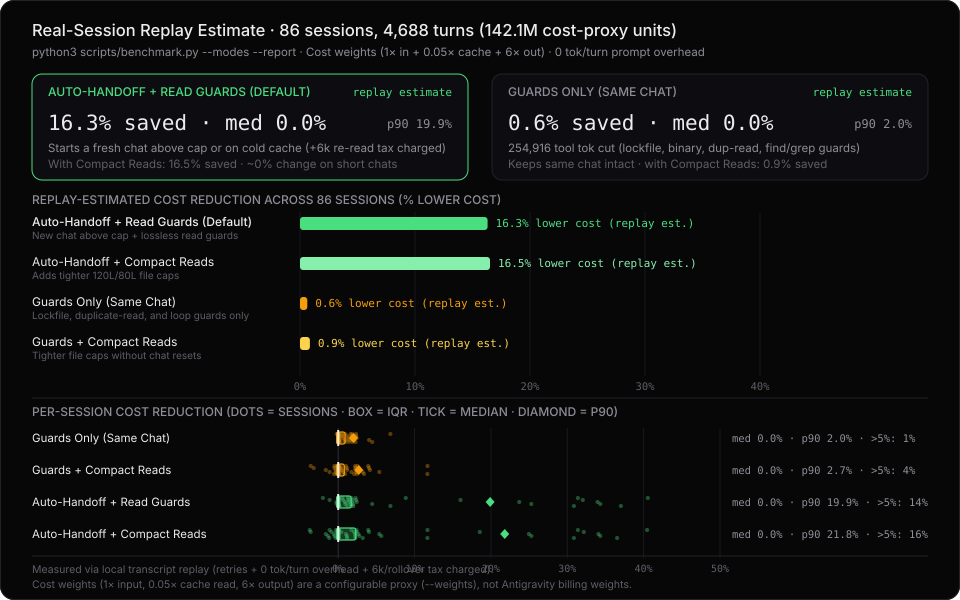

# Performance, Benchmarks and Latency

Every figure below comes directly from running commands in this repository (`eval/runner.py` and `scripts/benchmark.py`). Live end-to-end runs measure actual completion and API token usage; transcript replay numbers are **counterfactual replay estimates** assuming unchanged post-handoff trajectories (`+6k` re-read tax per rollover).

## 1. Live Multi-Turn Long-Session A/B (`eval/results/ab_long_eval.json`)

Executed via `agentapi new-conversation` + `agentapi send-message` on **`gemini-4-hydrogen-high`** across **3 multi-module 6-turn sequences (`L01`–`L03`) × 3 runs × 2 modes = 18 sessions (`108` user turns)**:

- **Arm A (`off`):** Single continuous 6-turn conversation (`115k -> 136k` peak context).
- **Arm B (`default`):** Real Auto-Handoff reset after Turn 3 via `scripts/handoff_pack.py` (`~533`-token packet) into a fresh conversation (`92k -> 75k` peak context) + Read Guards enabled.

| Mode | Pass Rate | 95% Wilson CI | Total Tokens | Cost Proxy | Mean Peak Context (Before -> After Split) | Handoff Packet |
| :--- | ---: | ---: | ---: | ---: | ---: | ---: |
| **off** (unbroken) | `9/9` (`100.0%`) | `70.1..100.0%` | `18,252,620` | `3,974,219` | `115,432 -> 136,483` | — |
| **default** (Auto-Handoff) | `9/9` (`100.0%`) | `70.1..100.0%` | **`12,429,894` (`-31.9%`)** | `4,084,987` (`+2.8%`) | `91,961 -> 75,048` | `533 tok` |

Per-task Cost Proxy (`1x` input + `0.05x` cache + `6x` output): `L01` **-9.0%** (`-35.9%` tok), `L02` **+1.0%** (`-37.8%` tok), `L03` **+21.8%** (`-19.0%` tok). In back-to-back turns with no idle pause (`~92%` cache hits at `0.05x`), cutting `-31.9%` total tokens trades nearly even on weighted cost; savings turn strongly positive once sessions grow larger (`>150k`) or experience an idle cache eviction (`>90s`).

## 2. Live Hard Multi-Module Evaluation (`eval/results/hard_eval.json`)

Executed via `agentapi` on **`gemini-4-hydrogen-xhigh`** across **6 cross-module tasks (`X01`–`X06`) × 3 runs × 3 modes = 54 runs** (spanning `pricing.py`, `promotions.py`, `inventory.py`, `ledger.py`, `parser.py`, `rules.py`, `sinks.py`, `pipeline.py`, `21.6 KB` JSON, `85.5 KB` logs, `8.9 KB` YAML, and 2-phase `X06` handoff):

| Mode | Total Pass Rate | 95% Wilson CI | Total Tokens | Cost Proxy | `X01`–`X05` Standard | `X06` Continuity |
| :--- | ---: | ---: | ---: | ---: | :--- | :--- |
| **off** | `18/18` (`100.0%`) | `82.4..100.0%` | `18,528,389` | `7,642,180` | `15/15` (`14.99M` tok) | `3/3` single chat (`3.54M` tok) |
| **default** | `17/18` (`94.4%`) | `74.2..99.0%` | `15,626,345` (**`-15.7%`**) | `7,520,192` (`-1.6%`) | `14/15` (`11.68M` tok) | `3/3` (`446` tok pkt, `3.94M` tok) |
| **max** | `18/18` (`100.0%`) | `82.4..100.0%` | `14,052,566` (**`-24.2%`**) | `6,953,383` (**`-9.0%`**) | `15/15` (`11.13M` tok) | `3/3` (`445` tok pkt, `2.92M` tok) |

On the legacy baseline suite (`eval/results/live_eval.json`, `90` runs on `flash` across `T01..H04`), all three modes scored `30/30` (`100.0%`) with `max` cutting `-9.8%` tokens (`-16.8%` output) on standard tasks.

## 3. Counterfactual Replay Estimate (`python3 scripts/benchmark.py --modes --report`)

Replayed across **86 local Antigravity sessions** (`4,688` turns, `142.1M` cost-proxy units; `0` tokens/turn prompt overhead; cost mix `38.7%` input / `31.0%` cache / `30.4%` output) gated strictly on exact `USER_INPUT` turn boundaries (`followed_by_user`):

| Mode | Tool Tok Cut | Median Session | Est Cost Saved (Replay) | p90 Session | Max Session | >5% Share |
| :--- | ---: | ---: | ---: | ---: | ---: | ---: |
| **Auto-Handoff + Read Guards (Default, Path 2 Delegated)** | `254,916 tk` | `0.0%` | **16.3% est. saved** | `19.9%` | `40.5%` | `14.0%` |
| **Auto-Handoff + Read Guards (Path 1 Direct 0-tok)** | `254,916 tk` | `0.0%` | **20.9% est. saved** | `28.0%` | `48.2%` | `18.6%` |
| **Auto-Handoff + Compact Reads (Path 2 / Path 1)** | `381,970 tk` | `0.0%` | **16.5% / 21.1% saved** | `21.8%` / `28.6%` | `40.5%` / `48.1%` | `16.3%` / `20.9%` |
| **Guards Only (Same Chat)** | `254,916 tk` | `0.0%` | **0.6% est. saved** | `2.0%` | `6.8%` | `1.2%` |
| **Guards + Compact Reads (Same Chat)** | `381,970 tk` | `0.0%` | **0.9% est. saved** | `2.7%` | `11.7%` | `3.5%` |

By session length (`86` sessions, Path 2 Delegated / Path 1 Direct): `<75k` (`31` chats, avg `49k`): `0.2%` / `0.2%`; `75k–110k` (`8`, `91k`): `0.1%` / `0.1%`; `110k–200k` (`12`, `153k`): `1.4%` / `4.2%`; `200k–400k` (`26`, `292k`): `9.0%` / `13.1%`; `>400k` (`9`, `472k`): `24.1%` / `29.6%`. Upper bound (with mid-run phase resets): `38.9%`.

## 4. Cost-Proxy Sensitivity (`--weights`)

| Weight Regime (`in / cache / out`) | Basis | Guards Only | Guards + Compact | Default Path 2 (Delegated) | Default Path 1 (Direct) |
| :--- | :--- | ---: | ---: | ---: | ---: |
| **Default (`1 / 0.05 / 6`)** | Frontier API ratio proxy | `0.6%` | `0.9%` | `16.3%` | `20.9%` |
| **Anthropic-style (`1 / 0.10 / 5`)** | 10% cache read / 5× out | `0.7%` | `1.0%` | `19.9%` | `23.9%` |
| **Output-light (`1 / 0.05 / 3`)** | Lower output multiplier | `0.7%` | `1.0%` | `19.2%` | `24.6%` |
| **Cache-heavy (`1 / 0.25 / 5`)** | Expensive cache reads | `0.8%` | `1.1%` | `23.5%` | `26.4%` |

## 5. Synthetic Hook Fixture (`python3 scripts/benchmark.py --demo`)

The 7-step deterministic hook benchmark tests blocked lockfiles, large source/JSON/log auto-caps, duplicate slice blocks, `node_modules` excludes, and lazy-truncation write blocks using `python3 -S`: direct tool tokens drop **77.6%** (`45,413` -> `10,181` tokens, median PreToolUse latency **30.0 ms**). Do not extrapolate this synthetic worst-case fixture to normal editing sessions.
